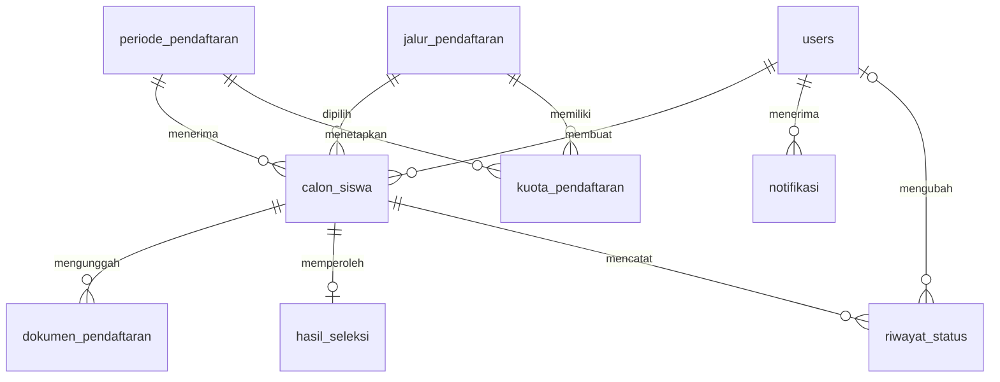

# PPDB Smart

## Identitas

- **Nama:** Gabriel Mesly Managam Siahaan
- **NRP:** 5025251096 
- **Kelas:** B
- **Mata kuliah:** Pweb

## 1. Nama Proyek

**PPDB Smart — Sistem Penerimaan Peserta Didik Baru**

## 2. Deskripsi Proyek

PPDB Smart adalah aplikasi web untuk mengelola proses penerimaan peserta didik baru. Calon siswa dapat membuat akun, mengisi formulir pendaftaran, mengunggah dokumen persyaratan, dan memantau status serta pengumuman hasil seleksi. Admin mengelola periode dan kuota pendaftaran, memeriksa dokumen, memproses pendaftaran, serta mengumumkan hasil seleksi.

Aplikasi dibuat dengan PHP native dan MySQL. Antarmuka responsif berbahasa Indonesia berkomunikasi dengan REST API JSON untuk mengambil dan mengubah data.

## 3. Tujuan Proyek

- Memudahkan calon siswa mengisi dan mengirim pendaftaran secara daring.
- Membantu admin mengelola periode, jalur, kuota, dokumen, dan hasil seleksi.
- Menyediakan informasi status pendaftaran dan pengumuman hasil secara terpusat.
- Menerapkan validasi data dan pembatasan akses berdasarkan peran pengguna.

## 4. Ruang Lingkup dan Spesifikasi

### A. Pengelolaan Data

- **Akun pengguna:** nama, email, kata sandi yang di-hash, dan peran siswa atau admin.
- **Periode pendaftaran:** nama periode, tanggal mulai dan selesai, serta status aktif/nonaktif.
- **Jalur dan kuota:** pilihan jalur pendaftaran serta kuota masing-masing jalur untuk suatu periode.
- **Data calon siswa:** nomor pendaftaran, identitas, alamat, data wali, jalur, periode, dan status.
- **Dokumen:** akta kelahiran, kartu keluarga, dan pas foto, termasuk status pemeriksaan dan catatan admin.
- **Seleksi dan notifikasi:** hasil seleksi, waktu pengumuman, pemberitahuan, serta riwayat perubahan status.
- **Basis data:** MySQL/MariaDB dengan relasi dan batasan integritas data.

### B. Alur dan Logika Pendaftaran

- Calon siswa membuat akun dan mengisi formulir pendaftaran untuk periode yang sedang dibuka.
- Formulir dapat disimpan sebagai draft sebelum dikirim.
- Pengiriman pendaftaran memerlukan tiga dokumen wajib: akta kelahiran, kartu keluarga, dan pas foto.
- Satu akun hanya dapat memiliki satu pendaftaran pada setiap periode.
- Admin mengelola periode, kuota jalur, pemeriksaan dokumen, status pendaftaran, dan hasil seleksi.
- Hasil seleksi hanya ditampilkan kepada siswa setelah admin mengumumkannya.
- Bukti pendaftaran dapat dicetak atau disimpan sebagai PDF dari browser; QR code nomor pendaftaran dibuat di sisi browser.

### C. Autentikasi dan Keamanan

- Login menggunakan session PHP; akses dashboard dibatasi menurut peran siswa atau admin.
- Kata sandi disimpan menggunakan `password_hash` dan diverifikasi dengan `password_verify`.
- Request yang mengubah data dilindungi token CSRF.
- Query database menggunakan PDO dan prepared statement.
- Dokumen dibatasi ke PDF, JPG, atau PNG dengan ukuran maksimal 5 MB.
- File disimpan di `storage/uploads` dan hanya dapat diakses melalui endpoint yang memeriksa hak akses.
- Validasi data penting dilakukan di server, termasuk format NISN, NIK, dan data formulir.

### D. Batasan Integrasi

- Email konfirmasi akun bersifat opsional dan memerlukan endpoint webhook yang dikonfigurasi.
- Pembayaran tidak termasuk dalam aplikasi ini karena proses PPDB tidak menetapkan biaya.
- Aplikasi tidak terintegrasi dengan layanan eksternal untuk memverifikasi dokumen atau menentukan hasil seleksi secara otomatis.

## 5. Fitur Utama

1. **Registrasi dan login** untuk akun siswa, serta login admin.
2. **Informasi periode dan jalur pendaftaran** yang tersedia pada halaman utama.
3. **Formulir pendaftaran bertahap** yang dapat disimpan sebagai draft.
4. **Unggah dokumen persyaratan** dan pemantauan status pemeriksaan dokumen.
5. **Dashboard siswa** untuk melihat pendaftaran, notifikasi, status, dan hasil seleksi yang telah diumumkan.
6. **Dashboard admin** untuk melihat ringkasan pendaftar dan mengelola pendaftaran.
7. **Pengelolaan periode dan kuota** untuk jalur pendaftaran yang tersedia melalui dashboard admin.
8. **Pemeriksaan dokumen dan perubahan status** oleh admin, termasuk catatan status.
9. **Penetapan dan pengumuman hasil seleksi** berdasarkan kuota yang dikelola admin.
10. **Cetak bukti pendaftaran** atau simpan sebagai PDF melalui browser.

## 6. Desain UI/UX dan Screenshot

Letakkan screenshot yang kamu ambil secara manual di folder **`screenshots/`** pada direktori utama proyek. Gunakan nama file berikut agar gambar langsung tampil di README:

### A. Halaman Utama


Menampilkan navigasi, informasi periode dan jalur pendaftaran, persyaratan, serta ringkasan alur pendaftaran.

### B. Halaman Masuk dan Registrasi


Halaman autentikasi menyediakan formulir masuk dan pembuatan akun calon siswa.

### C. Dashboard dan Formulir Calon Siswa

Masuk

Registrasi


Menampilkan data pendaftaran, formulir calon siswa, unggah dokumen, notifikasi, serta status dan hasil seleksi.

### D. Dashboard Admin


Menampilkan ringkasan pendaftar dan pengelolaan periode, kuota, dokumen, status pendaftaran, serta hasil seleksi.

> **Cara menambahkan screenshot:** simpan gambar dengan nama file yang tertera di atas ke folder `screenshots/`. Contoh: `screenshots/01-beranda.png`. Jika nama file berbeda, sesuaikan alamat gambar pada README.

## 7. Rancangan Basis Data

Entitas utama aplikasi dan relasinya:



Skema lengkap beserta data awal jalur pendaftaran tersedia di [`database/schema.sql`](database/schema.sql).

## 8. Teknologi yang Digunakan

- **Front end:** HTML, CSS, JavaScript, Bootstrap 5, Font Awesome.
- **Back end:** PHP native (disarankan PHP 8.1 atau lebih baru).
- **API:** REST API dengan respons JSON.
- **Database:** MySQL atau MariaDB melalui PDO.
- **Web server lokal:** Apache dan MySQL/MariaDB melalui XAMPP.

## 9. Struktur Proyek

```text
app/
  bootstrap.php        Session, koneksi PDO, autentikasi, CSRF, dan helper
api/
  index.php            REST API untuk siswa dan admin
assets/
  css/app.css          Gaya dan tata letak responsif
  js/app.js            Antarmuka dan pemanggilan API
config/
  config.php           Konfigurasi database dan email dari environment
database/
  schema.sql           Skema tabel dan data awal jalur
  create_admin.php     CLI untuk membuat akun administrator
storage/
  uploads/             Penyimpanan dokumen privat
screenshots/           Tempat menaruh screenshot README
index.php              Halaman utama aplikasi
router.php             Proteksi direktori privat untuk server PHP bawaan
```

Alur request: browser membuka `index.php`, JavaScript berkomunikasi dengan `api/index.php?action=...`, API memeriksa session/peran/token CSRF, lalu PDO mengakses MySQL. Dokumen diunduh melalui endpoint terotorisasi.

## 10. Cara Menjalankan dengan XAMPP (Windows)

1. Pasang XAMPP dengan PHP 8.1+ dan MySQL/MariaDB. Jalankan **Apache** dan **MySQL** dari XAMPP Control Panel.
2. Salin folder proyek ke direktori web XAMPP, misalnya `C:\xampp\htdocs\ppdb-smart`. Sesuaikan path berikut jika XAMPP terpasang di lokasi lain.
3. Buka `http://localhost/phpmyadmin`, pilih tab **SQL**, lalu jalankan isi file [`database/schema.sql`](database/schema.sql). File tersebut membuat database `ppdb_smart`, tabel, relasi, dan data awal jalur pendaftaran.
4. Periksa pengaturan database di [`config/config.php`](config/config.php). Nilai bawaan ditujukan untuk XAMPP standar: host `127.0.0.1`, port `3306`, database `ppdb_smart`, user `root`, dan password kosong.
5. Pastikan ekstensi PHP `pdo_mysql` dan `fileinfo` aktif di `php.ini`, kemudian restart Apache jika ada perubahan.
6. Buat akun admin melalui **Command Prompt**. Ganti path PHP dan folder proyek agar sesuai dengan instalasimu:

   ```bat
   C:\xampp\php\php.exe C:\xampp\htdocs\ppdb-smart\database\create_admin.php "Admin PPDB" admin@example.com "GantiPasswordKuat123!"
   ```

   Password admin minimal 12 karakter.
7. Buka `http://localhost/ppdb-smart/`, masuk sebagai admin, buat periode dan kuota jalur, lalu aktifkan periode agar calon siswa dapat mendaftar.

Alternatif untuk menjalankan proyek dari folder lain menggunakan server PHP bawaan:

```bat
C:\xampp\php\php.exe -S 127.0.0.1:8000 router.php
```

Jalankan perintah dari direktori proyek, lalu buka `http://127.0.0.1:8000`. Pastikan port tersebut tidak sedang digunakan Apache.

## 11. Konfigurasi Email Opsional

Untuk mengaktifkan email konfirmasi setelah registrasi, atur environment variable:

- `PPDB_EMAIL_API_URL`: URL webhook HTTPS yang menerima JSON dengan properti `to`, `subject`, dan `text`.
- `PPDB_EMAIL_API_KEY`: opsional, dikirim sebagai header `Authorization: Bearer ...`.

Tanpa konfigurasi endpoint, email tidak dikirim. Jika provider gagal, kegagalan dicatat di error log dan registrasi tetap berhasil.

## Catatan Penggunaan

- Jalur pendaftaran awal yang tersedia adalah Zonasi, Prestasi, dan Afirmasi. Admin dapat mengatur periode serta kuota melalui aplikasi.
- Dokumen yang diperlukan adalah akta kelahiran, kartu keluarga, dan pas foto dalam format PDF, JPG, atau PNG; ukuran maksimal masing-masing 5 MB.
- Sebelum digunakan di lingkungan produksi, atur kredensial database yang aman, aktifkan HTTPS, dan pastikan `storage/uploads` tidak dapat diakses langsung oleh web server.
